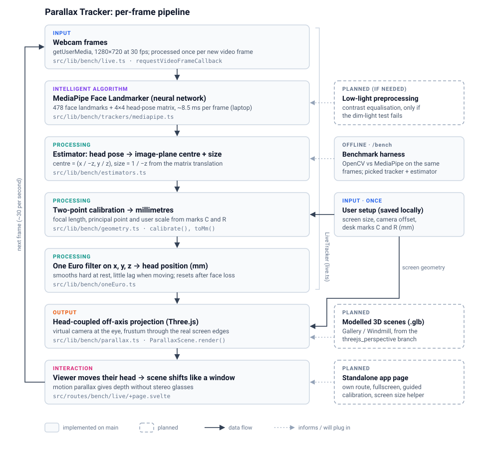

# Parallax Tracker: how the prototype works

A webcam tracks the viewer's head, and the 3D scene is re-rendered every frame from where their
eyes are. The screen behaves like a window into a box behind it: when you move your head,
near objects shift more than far ones (motion parallax), so the scene looks like it has depth
without stereo glasses.

Everything runs in the browser (SvelteKit + Three.js + TypeScript). No server or data leaves
the machine.



Solid boxes are implemented on `main` and run today at `/bench/live`. Dashed boxes are planned.
The [README](../README.md) explains how to run it.

## The pipeline, stage by stage

### 1. Input: webcam frames and a one-off setup

- **Webcam:** `getUserMedia` at 1280×720 and 30 fps. `requestVideoFrameCallback` runs the
  pipeline once per new camera frame, not per screen refresh, so no frame is processed twice.
- **Setup (once per machine, saved in the browser):** the visible screen size, where the webcam
  sits relative to the screen centre, and two desk marks. **C** is the normal sitting distance
  from webcam to eyes. **R** is a tape mark a known distance (e.g. 150 mm) to the side. Entered
  in `SetupFields.svelte`, stored by `screen.ts`.

### 2. Intelligent algorithm: MediaPipe Face Landmarker

`trackers/mediapipe.ts`. Google's MediaPipe Face Landmarker is a neural network (face detector +
mesh regressor) running in WebAssembly on the GPU, with a CPU fallback. Per frame it returns:

- 478 face landmarks in image pixels, including the irises
- a 4×4 **facial transformation matrix**: the head's pose relative to the camera

On our laptop it takes about 8.5 ms per frame, well inside the 33 ms between webcam frames.

The tracker is behind a small `Tracker` interface (`init`, `process(video, t)`, `dispose`).
That let us benchmark OpenCV against MediaPipe on identical frames (see
[How we chose the components](#how-we-chose-the-components)).

### 3. Processing: estimator, calibration, filtering

**Estimator** (`estimators.ts`). It reduces the tracker output to two numbers per frame: a
**centre** (where the head is in the image) and a **size** (how big it looks, which gives
distance). We use the translation `(x, y, z)` of the transformation matrix and project it to
centre = `(x / −z, y / z)`, size = `1 / −z`. The file also holds the other options we compared:
nose tip, eye corners, iris midpoint, iris diameter, face width, and so on.

**Calibration** (`geometry.ts`). It converts those measurements to millimetres with a pinhole
camera model, using no camera-calibration library. The user sits at mark C, then at mark R, and
the app averages 1.5 s at each:

- focal length `f = Δcentre_x × z0 / dx`: the head moved a known `dx` at a known distance `z0`
- principal point = the centre measured at C
- the user's real "size" = `size_C × z0 / |f|`. This is calibrated per person, so no average
  face dimensions are assumed.

After that, every frame becomes a head position:
`z = |f| × realSize / size`, `x = (cx − px) × z / f`, `y = −(cy − py) × z / |f|`.

**Filtering** (`oneEuro.ts`). A One Euro filter (Casiez et al., CHI 2012) runs on each axis. It
is a low-pass filter whose cutoff rises with speed, so the scene doesn't shimmer when you sit
still and doesn't lag when you move. If the face is lost for more than 250 ms the filters reset,
so the scene doesn't glide in from a stale position.

Stages 1–3 are wrapped by one class, `LiveTracker` (`live.ts`). It opens the camera, runs the
tracker per frame, handles the calibration samples, and calls back with a filtered `{x, y, z}`
in mm.

### 4. Output: head-coupled off-axis projection

`parallax.ts`, class `ParallaxScene`. The scene's world units are millimetres, and the physical
screen is the plane `z = 0`. Each frame, the virtual camera is placed at the tracked eye
position (shifted by the webcam's offset from the screen centre). Its projection is an
asymmetric (off-axis) frustum passing exactly through the four real screen edges. That is what
makes the screen act as a window rather than a camera orbiting the object. The demo scene is a
gridded box receding 400 mm behind the screen, with spheres at different depths, one of them in
front of the screen.

### 5. Interaction

Nothing is clicked during use: the viewer just moves. Leaning sideways reveals the sides of the
objects, and leaning in widens the view. The loop repeats for every camera frame (about 30 per
second). The page `src/routes/bench/live/+page.svelte` connects it all and also shows FPS,
processing time and the live x/y/z in mm.

## How the components connect

```ts
const tracker = await createTracker('mediapipe'); // Tracker interface
const live = new LiveTracker(tracker, videoEl, (u) => (position = u.position)); // stages 1–3
await live.start();
live.setCombo({ centre: 'poseMatrix', size: 'poseMatrix' });

const c = await live.sample(); // user sits at mark C
const r = await live.sample(); // user sits at mark R
live.calibrateFrom(c, r, setup.marks);

const scene = new ParallaxScene(canvas, setup.screen); // stage 4
requestAnimationFrame(function loop() {
	if (position) scene.render(position); // eye position in mm
	requestAnimationFrame(loop);
});
```

Data passed between stages:

| From → to               | Type                                                     |
| ----------------------- | -------------------------------------------------------- |
| Webcam → tracker        | `HTMLVideoElement` frame + timestamp                     |
| Tracker → estimator     | `TrackFrame { landmarks: Vec2[] \| null, pose? }`        |
| Estimator → calibration | `{ centre: Vec2, size: number }`                         |
| Calibration → filter    | `Vec3` in mm (raw)                                       |
| Filter → renderer       | `Vec3` in mm (filtered), camera space, z = toward viewer |

The tracker, the estimator and the renderer don't know about each other. Swapping MediaPipe for
another tracker, or the demo scene for a modelled one, touches one stage only.

## How we chose the components

We didn't assume a tracker. We built a benchmark (`/bench`, code in `src/lib/bench/`) that
records a scripted 2½-minute session and replays the same frames through each candidate. Pass
criteria were written down in `criteria.ts` beforehand. Full results are in
[`facialID-test/README.md`](../facialID-test/README.md).

|                              | MediaPipe | OpenCV (Haar + Facemark LBF) |
| ---------------------------- | --------- | ---------------------------- |
| Time per frame, laptop (p95) | 10.8 ms   | 27.5 ms                      |
| Frame rate, phone            | 26 fps    | 8 fps                        |
| Face found while leaning in  | 100%      | 71%                          |
| Jitter at the side mark      | 4 mm      | 142 mm                       |

Among MediaPipe's outputs, the transformation matrix had the least jitter and was the least
fooled by head turns. Iris size was rejected because blinks made the scene jump up to 53 mm.

## Status: built vs. planned

| Part                                      | Status                                                          |
| ----------------------------------------- | --------------------------------------------------------------- |
| Webcam → MediaPipe → mm → filter → render | **Working** at `/bench/live`                                    |
| Benchmark, replay, blind A/B test pages   | **Working** at `/bench`, `/bench/blind`                         |
| Modelled scenes (Gallery, Windmill .glb)  | On the `threejs_perspective` branch, mouse-driven; to be merged |
| Standalone app page                       | Planned: own route, fullscreen, guided calibration              |
| Screen size without a tape measure        | Planned                                                         |
| Low-light preprocessing (OpenCV)          | Only if the pending dim-light test shows MediaPipe losing faces |

Known limitations: one face only; Chrome/Edge recommended; tested so far by one participant in
normal lighting; absolute mm accuracy is approximate (±10–20%), though relative movement, which
is what drives the parallax, is consistent.
